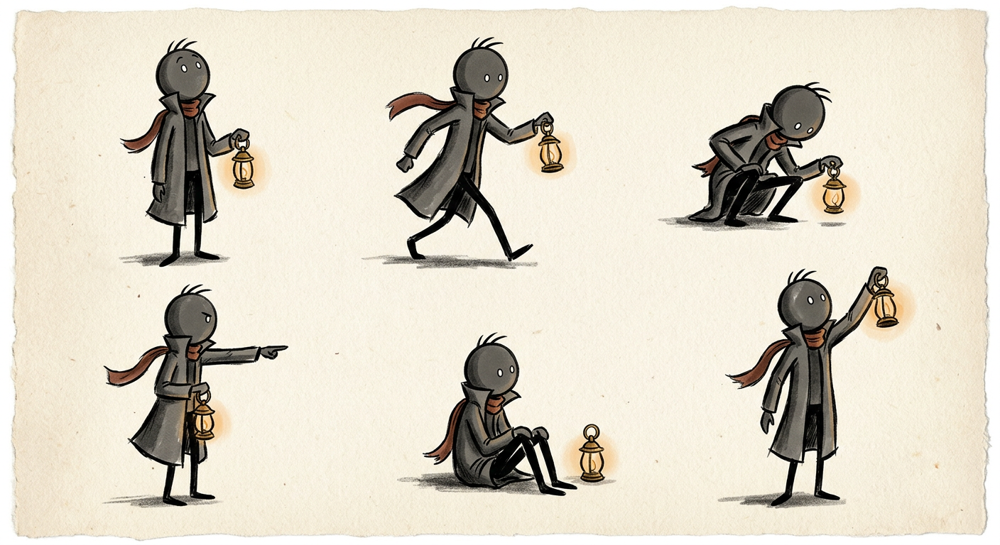

# WICK — Character Bible

## Who he is

**Wick** is a stickman in a long charcoal coat with the collar up, a rust-red scarf, and a brass lantern he never puts down.

He is not a host. He does not explain, joke, or point at diagrams. **He is the witness.** He is present at every real event the channel covers — in the corner of the room, at the rail of the ship, on the seabed, in the crowd — and he carries the only light. Whatever the camera can see, Wick has already seen it.

This single rule does three things: it gives every episode a signature detail, it makes the brand instantly recognisable at small sizes, and it lets us dramatise without inventing dialogue, because Wick never speaks.

**Tagline:** *He was there. He carries the light.*

## Visual spec (must be identical in every plate)

| Element | Spec |
|---|---|
| Head | Perfect circle, no jaw, no nose. Two small pale dots for eyes, set wide, never expressive. Three short hair strokes, swept back. |
| Body | Single tapered ink stroke for spine; thin limbs; simple hands. Total figure = round head + ~10 strokes. |
| Coat | Long, charcoal-grey/slate, collar turned up, hem flares when moving. Cross-hatched shading, no colour fill beyond slate. |
| Scarf | **Rust red `#A2452F`** — the only rust in the frame. Trails behind him when there is movement. |
| Lantern | Small brass lantern, amber glow `#E7A34C`, always lit, always the brightest warm point in his vicinity. |
| Line | Hand-inked, tapered, slightly wobbly. Never uniform vector strokes. |

## How he appears on screen

- Height: **6–10% of frame height** in episode plates. He is a witness, not a hero — the story must be able to happen without him in the foreground.
- Placement: bottom-left or bottom-right corner, in shadow, never dead centre, never blocking the subject.
- Stance: watching, crouching, or standing at a rail. He **never** touches the story's props, never pulls a lever, never rescues anyone.
- When the scene is dark, his lantern is the only warm light. When the scene is bright, he stands just outside it.
- In the channel avatar and thumbnails he may be shown at bust scale, once per asset.

## Personality (for tone, not for dialogue)

- Patient. He has watched a lot of people run out of time.
- Not sentimental. He records.
- Quietly on the side of the people in the story. When someone survives, he is the one standing a little apart at the end, lantern down.

## What he never does

- No talking, no text bubbles, no emoting with eyebrows or mouth (he has neither).
- No weapons, no magic, no superpowers, no fourth-wall winks.
- No redesigns. If a new artist or model draws him with a hat, a beard, a different coat, or a different scarf colour, it is off-brand and gets regenerated.

## Prompt block (copy-paste for every new plate)

> At the edge of the frame, small — about one tenth of the frame height — a stickman in a long charcoal coat with a rust-red scarf, holding a small brass lantern with a warm amber glow, standing quietly and watching. He does not interact with the scene.

Append that to the base style block in `episodes/*/images/PROMPTS.md`.

## Merch / future uses

The lantern is the logo mark; the scarf is the colour cue. A 30-second "Wick was there" bumper (lantern lights, ink floods the frame, title) is the natural channel trailer for week 4.
